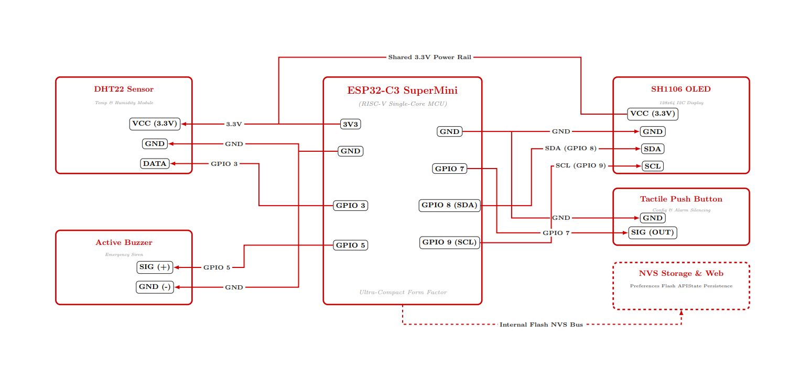
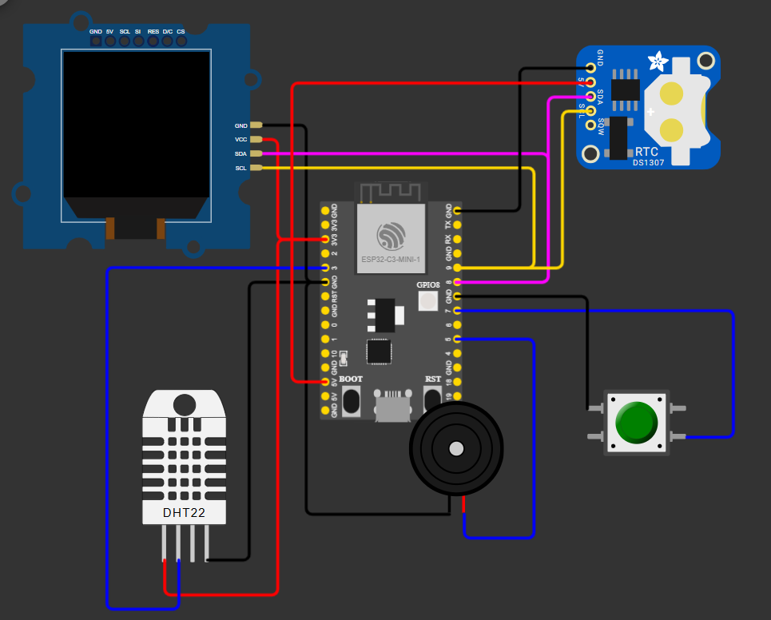

# Desk-Buddy: ESP32-C3 Desktop Companion & Smart Alarm Clock

Desk-Buddy is an embedded IoT desktop assistant built around the **ESP32-C3** RISC-V microcontroller and an **Adafruit SH1106G 128x64 I2C OLED display**. The system integrates expressive facial animations, a cyclic multi-screen telemetry dashboard, and a non-volatile flash-backed (NVS) alarm system driven by an external DS3231 RTC.

---

## Academic Context

- **Course:** Bachelor of Engineering (B.E.) in Electronics and Communication Engineering
- **Semester:** Semester 6
- **Subject:** Sensors and Transducers (Course Code: `3161008`)
- **Project Type:** Academic Mini Project
- **Focus Area:** Embedded sensor interfacing, digital signal acquisition, I2C/1-Wire communication protocols, and non-volatile configuration memory.

---

## Features

- **Expressive Companion Faces:** Procedural vector-drawn animated eyes and mouth expressions (Idle, Focused/Cat, Wink).
- **6-Screen Cyclic Dashboard (Telemetry Acquisition):**
  1. **Digital Clock:** Real-time hours, minutes, and seconds (`HH:MM:SS`).
  2. **Trigonometric Analog Clock:** Dynamically calculated hand vectors using sine and cosine angular projections.
  3. **Calendar View:** Current day of the week and date (`DD/MM`).
  4. **Temperature Monitor:** Real-time ambient readings via DHT22 sensor.
  5. **Relative Humidity:** Live ambient humidity percentage.
  6. **Alarm Status:** Configured trigger threshold preview.
- **Hardware-Debounced Long-Press Alarm Setup:**
  - Hold button for $\ge 3$ seconds to enter configuration mode.
  - Step-by-step Hour and Minute configuration with single-click increments.
  - 2-second idle auto-advance and automatic persistent storage using ESP32 NVS flash (`Preferences.h`).
- **Active Buzzer Integration:** Frequency-modulated audio alert with dedicated single-click alarm silencing and cool-down debounce protection.

---

## System Architecture & Schematics

### Circuit Schematic


> **Note:** The full vector schematic document is available in [`docs/Desk_Buddy_Circuit_Diagram.pdf`](docs/Desk_Buddy_Circuit_Diagram.pdf).

### Simulation Model
The circuit and firmware logic are fully modeled and verified in Wokwi.

- Wokwi simulation connections and parts are declared in [`diagram.json`](diagram.json).

---

## Hardware Specifications & Pin Mapping

| Component | Interface / Protocol | ESP32-C3 Pin | Description / Notes |
| :--- | :--- | :--- | :--- |
| **1.3" OLED (SH1106G)** | I2C (Address: `0x3C`) | SDA: `GPIO 8`<br>SCL: `GPIO 9` | 128x64 Monochrome Display (Fast I2C, 400 kHz) |
| **DS3231 RTC Module** | I2C (Shared Bus) | SDA: `GPIO 8`<br>SCL: `GPIO 9` | High-precision battery-backed hardware RTC |
| **DHT22 (AM2302)** | 1-Wire Digital | Data: `GPIO 3` | Calibrated ambient temperature & humidity sensor |
| **Active Buzzer** | Digital Output | `GPIO 5` | Audible piezo alarm alerting |
| **Push Button** | Digital Input | `GPIO 7` | Internal pull-up (`INPUT_PULLUP`), active-LOW |
| **System Power** | Regulated Rail | `3V3`, `GND` | Common regulated power and ground rail |

---

## Finite State Machine (FSM)

```text
       [Normal Cycle]
        ├── 0s - 10s : Expressive Facial Animations
        └── 10s - 31s: 6-Stage Telemetry Carousel (3.5s per view)
               │
               ▼ (Hold Button >= 3 sec)
       [ALARM_CONFIG Mode]
        ├── Set Hours (Increment on single click)
        │     └── Auto-advance after 2s idle
        ├── Set Minutes (Increment on single click)
        │     └── Save to NVS Flash & Exit after 2s idle